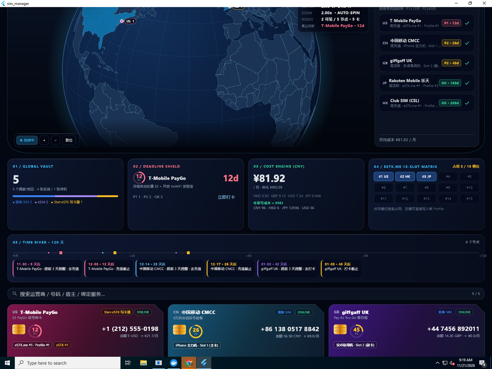
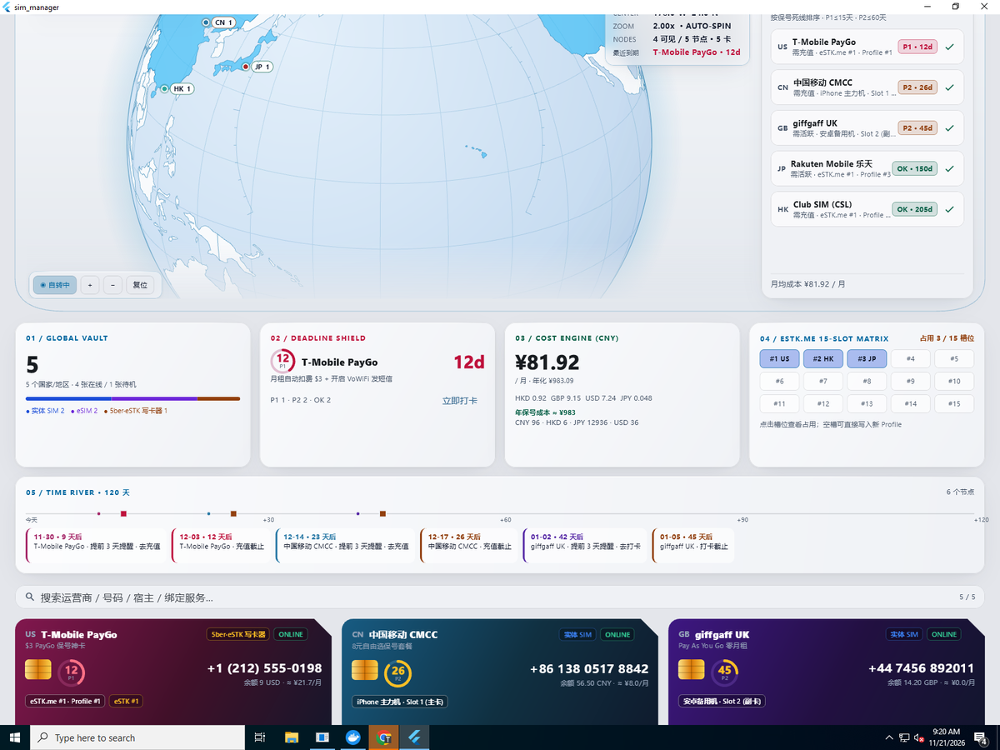
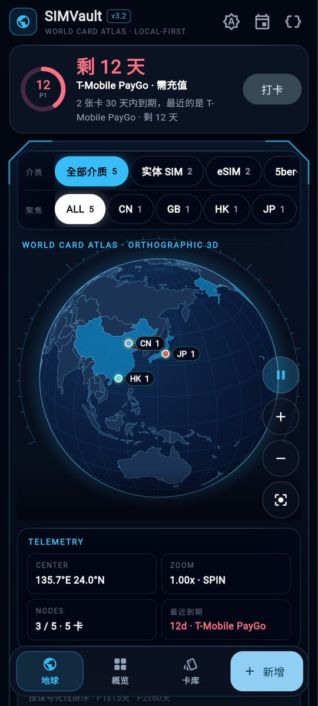
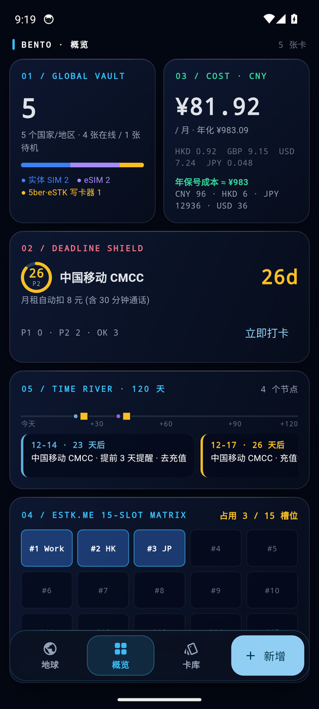
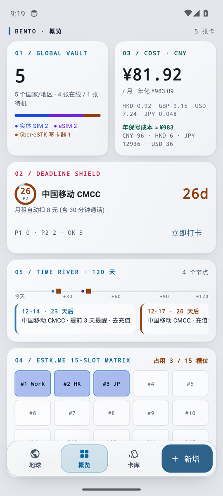
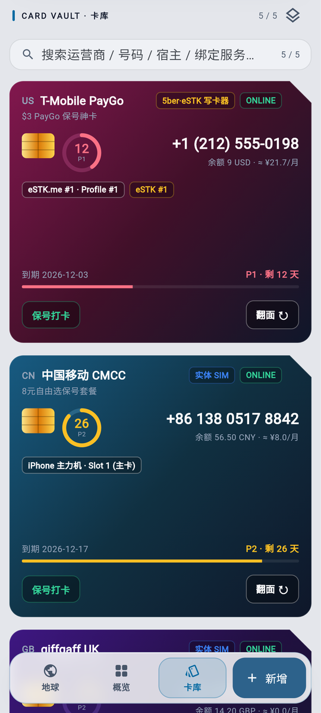
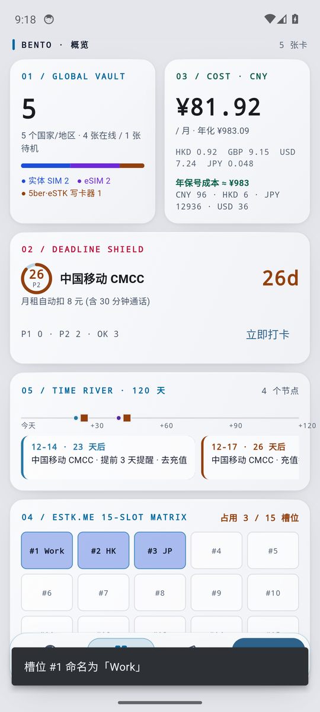
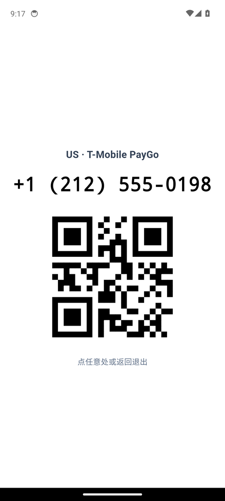
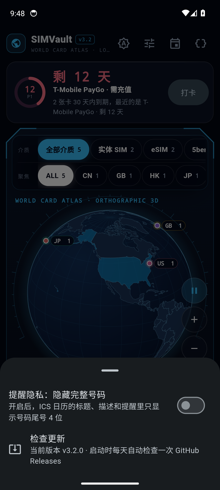
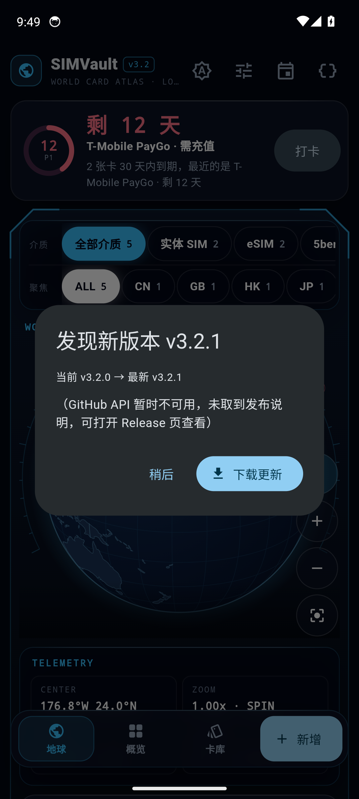

# SIMVault

全球 SIM/eSIM 收藏、套餐与保号管理工具。本项目坚持本地优先、无需登录、无后端上传，面向集卡党、跨境旅行者和多号码用户。

> Flutter 是跨平台移动端主应用；`android-native/` 是 Android 原生 Compose 路线 C；`simvault/` 是可离线安装的 Web/PWA 版本。

## 主页与下载

- 项目主页：<https://liuduobee.github.io/sim-manager/>
- GitHub Releases：<https://github.com/LiuDuobee/sim-manager/releases>
- Flutter 原生 v3.0.0：<https://github.com/LiuDuobee/sim-manager/releases/tag/v3.0.0>
- Android Compose 原生 v3.1.0：<https://github.com/LiuDuobee/sim-manager/releases/tag/v3.1.0>

## 截图

| 桌面 · 深色 | 桌面 · 浅色 |
|---|---|
|  |  |

| 手机 · 地球（深色） | 手机 · Bento（深色） | 手机 · Bento（浅色） | 手机 · 卡库（浅色） |
|---|---|---|---|
|  |  |  |  |

| 15 槽 eSTK 矩阵 | 出示号码 | 检查更新 | 新版本提示 |
|---|---|---|---|
|  |  |  |  |

## 功能（Flutter 主应用 v3.4.0）

**World Card Atlas 本体**
- 真实地理数据的 3D 正射地球：离线打包 world-atlas `countries-110m`，背面半球与节点剔除；拖拽旋转、自转、惯性滑行、点国家或快捷条飞到该国；滚轮/双指缩放 1.0x–2.0x，始终裁剪在 HUD 舞台内。
- HUD 半舱：介质筛选（实体 SIM / eSIM / 5ber·eSTK）、国家聚焦、遥测读数。
- 45° 切角 3D 翻转卡：正面运营商/号码/到期，背面 ICCID/保号规则/护照/操作。
- 载体矩阵：可登记多个载体（可复写 eUICC 卡如 eSTK / 9eSIM / XeSIM / Switch 等品牌型号预设、手机内置 eSIM），各自按容量渲染槽位（多则滚动），点槽位看对应卡，槽位可起 Profile 昵称；旧数据自动迁移为一个 15 槽 eSTK 载体。
- Bento 统计：最近死线、智能摘要、倒计时圆环、按币种汇总的年保号成本、120 天时间河。

**卡片与保号**
- 表单选项：国家/地区选择器（带国旗、可搜索；中国下分大陆/香港/澳门/台湾）、按地区预设运营商、ISO 币种选择器，选地区联动默认运营商与币种。
- 预付 / 上台、用途类型（号码卡 / 纯流量卡 / 旅游卡 / 物联网卡 / 其他）与来源平台；流量卡和旅游卡记录总流量与套餐有效期，卡面倒计时显示套餐到期。
- 卡面地区国旗与旗色色带；保号周期 30/60/90/180/360 天档位 + 自定义。
- 新增 / 编辑 / 归档（可恢复，归档里可彻底删除），删除与归档都有撤销条。
- 保号规则：活跃度型 / 有效期型，续期按原到期日顺延或按操作当天重算；内置 7 个运营商预设（周期、类型、充值链接、预估年成本，可改）。
- 保号打卡（5 秒内可撤销）、续费护照（打卡、充值、编辑全部留痕）。
- 智能录入：扫卡托条码读 ICCID（安卓，拒绝相机权限时改手动输入）；粘贴充值短信自动识别金额和到期日，确认后才写入。
- 出示号码：全屏大字号码 + 二维码。
- 标签筛选；每张卡多个提醒偏移。
- 费用字段禁止负数（表单与数据层双重校验，非法记录隔离保存）。

**导出与设置**
- 导出 ICS 日历：每张卡多条 VALARM，按动作区分「打卡」「去充值」文案。
- JSON 备份导出 / 导入（旧版本备份可直接导入）。
- 主题：浅色 / 深色 / 跟随系统（实时跟随）；顶栏、手机底部导航坞和底部弹层是真毛玻璃（背景模糊 + 饱和度提升 + 顶部高光），内容从玻璃下滑过，高对比度模式下改为实色。
- 隐私开关：ICS 里只显示号码尾号 4 位。
- 自动更新：启动时每天最多检查一次 GitHub 最新正式 Release，同一版本只提示一次；设置页可手动「检查更新」。安卓按设备 ABI 下载对应 APK 并拉起系统安装器；Windows 下载 zip 解压到「下载」文件夹并打开，由你手动运行新版（不会静默替换当前程序）。

**安卓手机布局**：窄屏单独的竖屏布局（地球 / 概览 / 卡库三段 + 底部导航坞）、单指拖拽、双指缩放、48dp 触控目标、沉浸式状态栏。

## 安装

**Windows**：从 [Releases](https://github.com/LiuDuobee/sim-manager/releases/latest) 下载 `SIMVault-v<版本>-windows-x64.zip`，解压后运行 `sim_manager.exe`。没有安装程序，删除文件夹即卸载。

**Android**：下载与手机 CPU 对应的 APK 安装（需允许「安装未知应用」）：
- `arm64-v8a`：近几年的绝大多数手机，不确定就选它
- `armeabi-v7a`：较老的 32 位手机
- `x86_64`：模拟器 / 部分平板

以后可在 App 里直接更新。从 v3.3.0 起，安卓 APK 都用同一把发布密钥签名（证书 SHA-256 `E7:41:89:1A:99:B4:EE:27:C4:DE:DD:34:85:7E:F2:B6:89:47:02:BC:F1:98:E1:FA:4A:EB:66:3F:B3:AD:BC:42`），可以直接覆盖安装；从 v3.2.1 及更早版本升级需先「复制 JSON」备份、卸载后重装一次。

## 系统要求

- Windows 10 / 11 64 位
- Android 7.0（API 24）及以上

## 数据与隐私

- 所有卡片数据只保存在本机（`SharedPreferences`），没有账号、没有服务器、不上传任何卡片数据。
- 唯一的联网请求是检查更新：访问 GitHub Releases 获取最新版本信息并下载安装包，不携带任何卡片数据。
- 换机或重装前请用「JSON 备份」导出。安卓卸载 App 会清除 App 内数据和 App 目录里的备份文件，请用「复制 JSON」把备份存到 App 之外。

## 目录

- `lib/`：Flutter 跨平台主应用
- `android-native/`：Kotlin + Jetpack Compose + MVI Android 原生路线 C
- `simvault/`：React/Vite/Dexie 离线 Web/PWA 实验版本

## 运行

```bash
flutter pub get
dart format .
flutter analyze
flutter test
flutter run
```

### 安卓正式签名

`flutter build apk --release` 从 `android/key.properties` 或环境变量读取发布密钥；两者都没有时退回调试密钥（仅供本地调试，不能发布）。`key.properties`、`*.jks`、`*.keystore` 已在 `.gitignore` 中，切勿提交。

```properties
# android/key.properties
storeFile=/绝对路径/simvault-release.jks
storePassword=...
keyAlias=simvault
keyPassword=...
```

对应环境变量：`SIMVAULT_KEYSTORE`、`SIMVAULT_KEYSTORE_PASSWORD`、`SIMVAULT_KEY_ALIAS`、`SIMVAULT_KEY_PASSWORD`（优先于 `key.properties`）。

## 许可证

GPL-3.0-or-later。欢迎提交 Issue 和 Pull Request。
