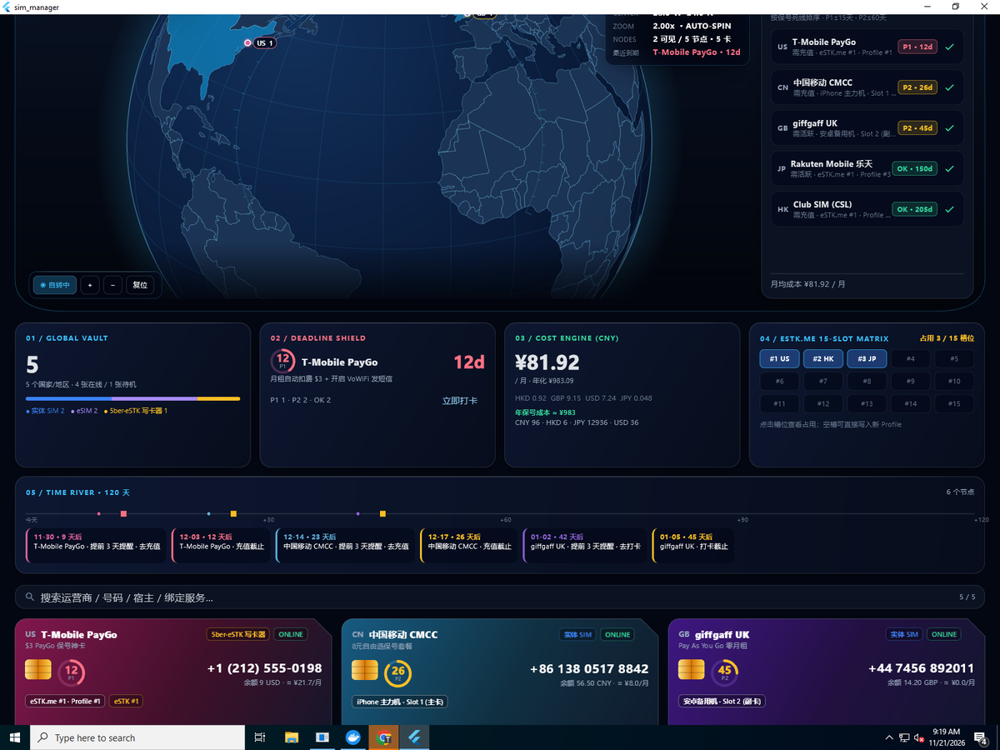
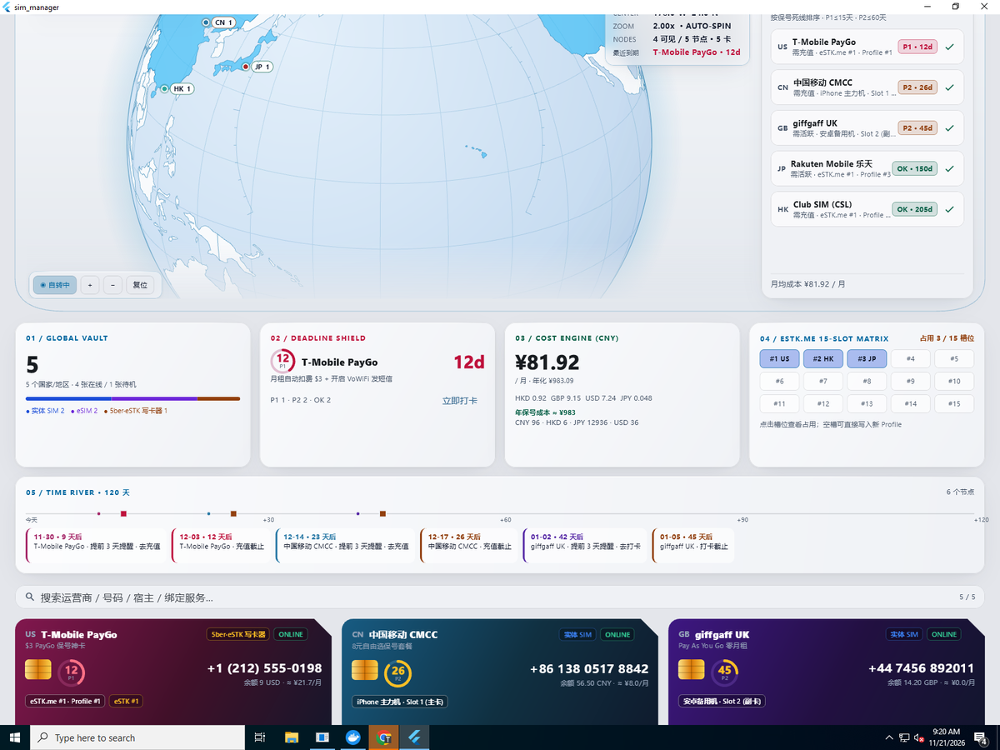
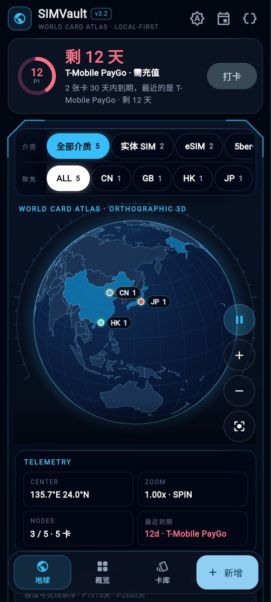
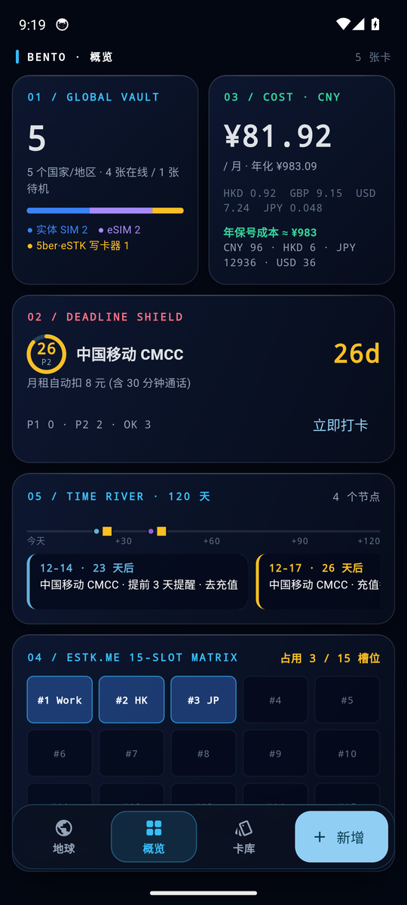
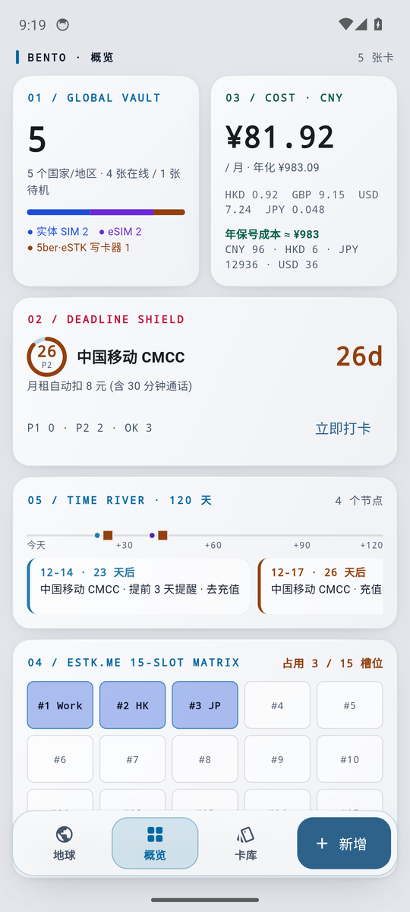
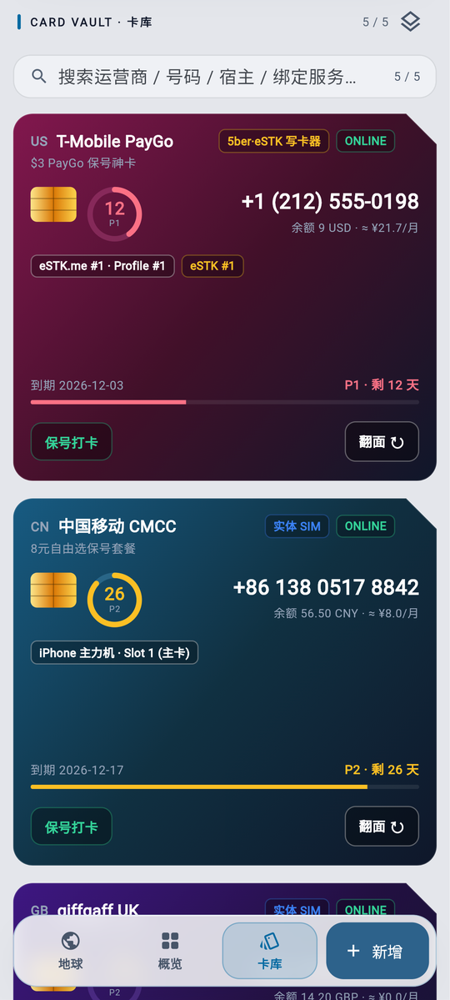

# SIMVault v3.3.0 · World Card Atlas

这是 v3.2.1 之后的第一个正式版，合并了 10 个 PR：World Card Atlas 本体、安卓手机布局、主题三档、保号规则与运营商预设、续费护照、归档、年成本、UI 美化、二期七项，以及**自动更新**。从这个版本起，App 可以自己检查和下载新版本。

**为什么叫 3.3.0：** 新增了大量功能，旧数据和旧备份完全兼容，没有破坏性变更，所以按语义化版本升次版本号。

## 截图

| 桌面 · 深色 | 桌面 · 浅色 |
|---|---|
|  |  |

| 手机 · 地球（深色） | 手机 · Bento（深色） | 手机 · Bento（浅色） | 手机 · 卡库（浅色） |
|---|---|---|---|
|  |  |  |  |

## 完整功能

**World Card Atlas 本体**
- 真实地理数据的 3D 正射地球（离线 world-atlas `countries-110m`），背面半球与节点剔除；拖拽、自转、点国家或快捷条飞到该国。
- HUD 半舱：介质筛选、国家聚焦、遥测读数。
- 45° 切角 3D 翻转卡；15 槽 eSTK 点阵矩阵（按真实可编程卡占用）；Bento 统计。
- 新增 / 编辑、本地持久化、到期紧急度、保号打卡、ICS 导出、JSON 备份导入导出。

**自 v3.2.1 以来的新功能**
- **自动更新**：启动时每天最多检查一次 GitHub 最新正式 Release，同一版本只提示一次；设置页可手动检查。安卓按 CPU 架构下载 APK 并拉起系统安装器；Windows 下载 zip 解压到「下载」并打开文件夹，手动运行新版（不会静默替换）。
- **费用禁止负数**：表单提示并拒绝保存；加载和导入时负数记录被拦下、隔离保存。
- **地球缩放修复**：滚轮/双指缩放限定 1.0x–2.0x，地球始终裁剪在 HUD 舞台内；鼠标在地球上时滚轮只缩放不滚页面。
- **安卓手机布局重构**：竖屏单独布局（地球 / 概览 / 卡库 + 底部导航坞）、双指缩放、48dp 触控目标、沉浸式状态栏。
- **主题三档**：浅色 / 深色 / 跟随系统（实时跟随），浅色按 Solid Glass 令牌做整套调色板。
- **保号规则与运营商预设**：活跃度型 / 有效期型 + 两种续期算法；7 个运营商预设自动带出周期、充值链接和年成本。
- **续费护照**：打卡、充值、编辑全部留痕，打卡 5 秒内可撤销。
- **归档**：替代直接删除，可恢复，归档里可彻底删除。
- **年成本**：Bento 按币种汇总全部卡的年保号成本，单卡显示年成本。
- **UI 美化**：倒计时圆环、运营商品牌色、最近死线 + 智能摘要、弹簧动效与触感反馈、打卡盖章、手机卡叠模式、删除/归档撤销条、空状态引导、无障碍（高对比度、减少动态、字体缩放）。
- **二期七项**：时间河（120 天）、智能录入（扫 ICCID、粘贴短信解析）、出示号码（大字 + 二维码）、多提醒偏移与 ICS 多条 VALARM、标签筛选、ICS 号码隐私开关、eSTK 槽位昵称。

## 更新日志

- #2 World Card Atlas Flutter 版
- #4 费用字段禁止负数
- #5 地球缩放裁剪与 1.0x–2.0x 限制
- #6 安卓手机布局、双指缩放、48dp 触控
- #7 浅色 / 深色 / 跟随系统主题
- #8 保号规则、运营商预设、续费护照、归档、年成本
- #9 UI 美化专项
- #10 二期七项
- #11 自动更新

## 下载与安装

| 文件 | 适用 |
|---|---|
| `SIMVault-v3.3.0-windows-x64.zip` | Windows 10 / 11 64 位：解压后运行 `sim_manager.exe` |
| `SIMVault-v3.3.0-arm64-v8a.apk` | 绝大多数安卓手机（不确定就选它） |
| `SIMVault-v3.3.0-armeabi-v7a.apk` | 较老的 32 位安卓手机 |
| `SIMVault-v3.3.0-x86_64.apk` | 安卓模拟器 / 部分平板 |

安卓安装需允许「安装未知应用」。APK 签名证书 SHA-256：`E7:41:89:1A:99:B4:EE:27:C4:DE:DD:34:85:7E:F2:B6:89:47:02:BC:F1:98:E1:FA:4A:EB:66:3F:B3:AD:BC:42`，以后的版本都用同一把密钥签名。

**系统要求：** Windows 10 / 11 64 位；Android 7.0（API 24）及以上。

## 数据与隐私

卡片数据只保存在本机，没有账号和服务器。唯一的联网请求是向 GitHub Releases 检查和下载更新，不携带任何卡片数据。

## 已知问题

- **安卓正式版没有在真机上验证过。** 安卓界面和功能是在模拟器上用 debug 包验证的，release 包在没有 GPU 的模拟器上无法运行。
- **导出的 .ics 没有在日历 App 里实际导入测试过**，只用单元测试校验了文件内容。
- **v3.2.1 及更早版本的安卓用户需要卸载重装一次。** 旧版用的是临时调试签名，和本版不同，直接覆盖安装会提示「与现有软件包冲突」。请先在「JSON 备份」里点「复制 JSON」，把内容存到 App 以外的地方，卸载旧版、安装新版后再粘贴导入。**自 v3.3.0 起签名固定**，以后的版本可以在 App 里直接更新、覆盖安装。
- 运营商预设里的周期和费用是起始参考值，没有逐个和官网核对过，表单里可以修改。
- 扫 ICCID 没有用真实卡托条码测过（模拟器没有摄像头画面），识别逻辑有单元测试。
- 性能只在没有 GPU 的模拟器和 Windows 虚拟机上测过，帧构建低于 16.7ms，但没在真机上确认 60fps。
- Windows 版不会自动替换自身，更新后需手动运行解压出的新版。
