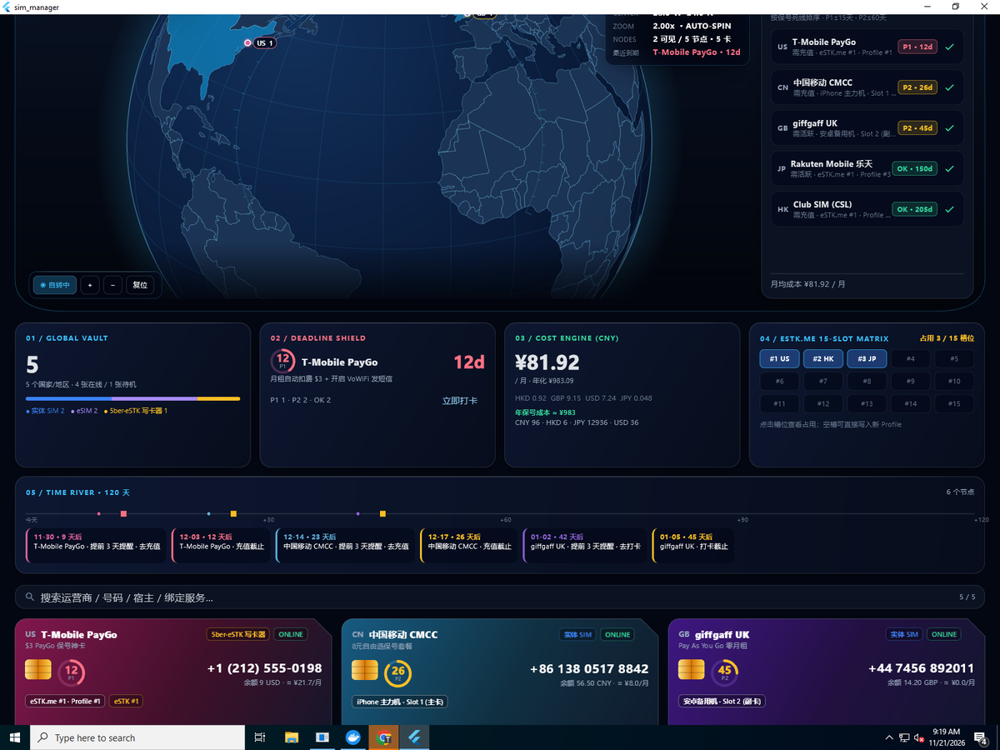
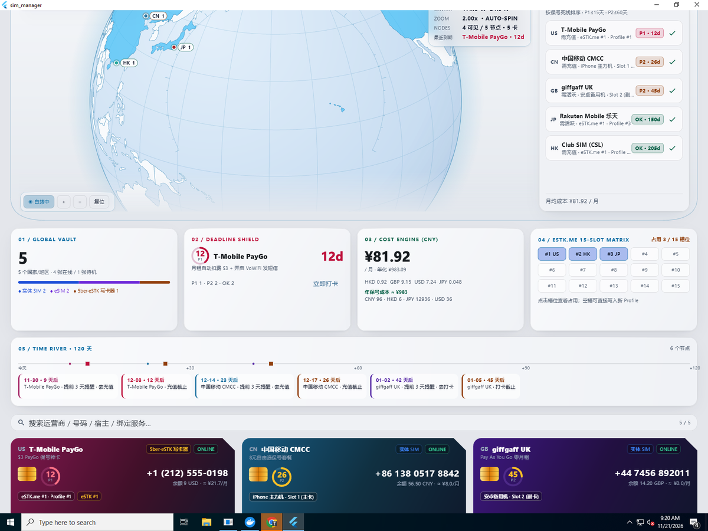
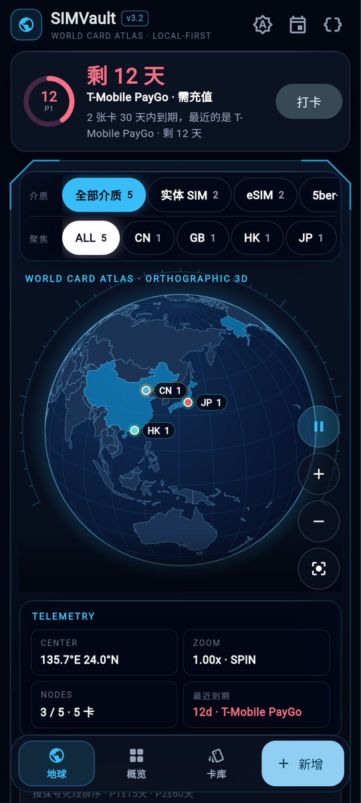
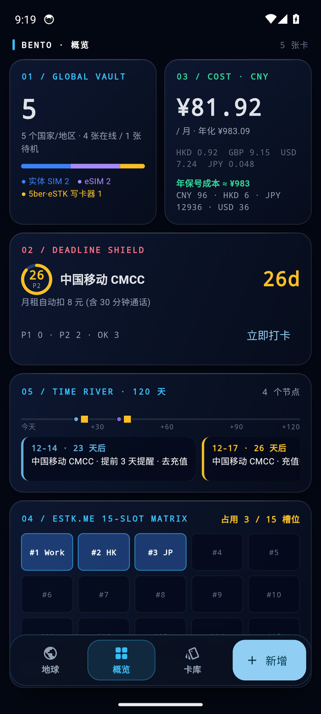
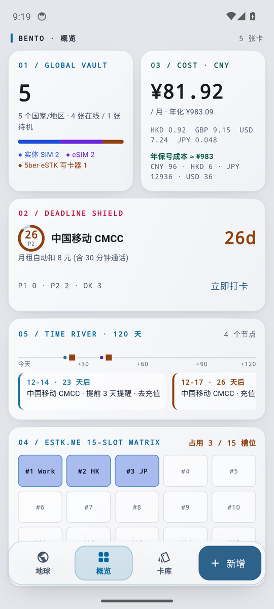
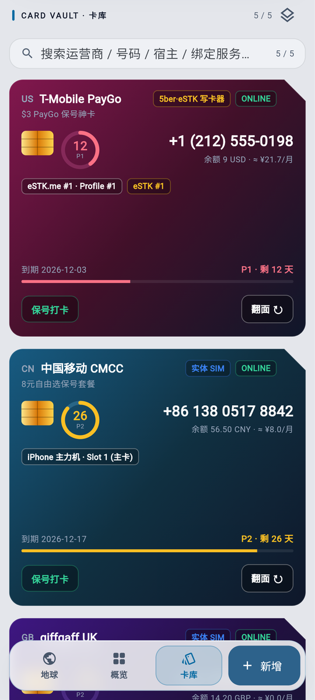

# SIMVault v3.4.0 · World Card Atlas

v3.3.0 之后的次版本更新，合并了 3 个 PR：表单选项与国旗区分、载体泛化与真毛玻璃、新 App 图标。旧数据和旧备份自动迁移、完全兼容，所以升次版本号。

## 新功能

**表单选项与国旗区分（#13）**
- 国家/地区选择器：带国旗、可搜索、可自定义；中国置顶，下分中国大陆 / 中国香港 / 中国澳门 / 中国台湾。
- 运营商按地区预设（大陆、港澳台、英、美、日、新加坡），选中带规则的运营商自动带出保号规则；任何地区都可自定义输入。
- 币种选择器：ISO 常用币种，按地区给默认值。
- 预付 / 上台：上台卡显示「上台」徽标、可筛选，默认不带保号规则。
- 保号周期档位：30 / 60 / 90 / 180 / 360 天 + 自定义天数。
- 卡面显示地区国旗，并加一条取自旗帜主色的色带。
- 用途类型：号码卡 / 纯流量卡 / 旅游卡 / 物联网卡 / 其他；流量卡和旅游卡有来源平台预设（Airalo、Holafly 等）、总流量和套餐有效期，卡面倒计时显示套餐到期，时间河收录到期事件；卡库可按类型筛选。

**载体泛化与真毛玻璃（#14）**
- 载体类型：运营商实体卡 / 设备内置 eSIM / 可复写 eUICC 卡。
- 可复写卡品牌型号预设（含 Profile 容量）：eSTK、9eSIM、XeSIM、BeeSIM、Switch、RoamHop、eSIM.me、eSIMKit、5ber（标注不推荐新购）、白卡/其他。
- 15 槽 eSTK 矩阵泛化为多载体矩阵：每个载体按容量渲染槽位（多则滚动），卡分配到载体 + 槽位；旧数据自动迁移为一个 15 槽的「eSTK」载体，行为不变；JSON 备份带上载体清单，旧备份仍可导入。
- 毛玻璃：顶栏、手机底部导航坞、底部弹层改为真背景模糊（σ22）+ 饱和度提升 + 顶部高光，内容从玻璃下滑过；高对比度模式下改为实色。

**新图标（#15）**
- 三色 SIM 卡扇形 + 地球的新图标：安卓自适应图标、Windows 多尺寸 .ico、Web/PWA 图标。

## 截图

| 桌面 · 深色 | 桌面 · 浅色 |
|---|---|
|  |  |

| 手机 · 地球（深色） | 手机 · Bento（深色） | 手机 · Bento（浅色） | 手机 · 卡库（浅色） |
|---|---|---|---|
|  |  |  |  |

截图为 v3.3.0 版本界面；v3.4.0 的新界面截图见 #13、#14 的 PR 说明。

## 更新日志

- #13 地区 / 运营商 / 币种选择器、预付与上台、用途类型、保号周期档位、国旗色带
- #14 载体登记与多载体矩阵、真毛玻璃顶栏 / 导航坞 / 弹层
- #15 新 App 图标

完整功能清单见 [README](https://github.com/LiuDuobee/sim-manager#readme)；v3.3.0 及更早的改动见 [v3.3.0 发布说明](https://github.com/LiuDuobee/sim-manager/releases/tag/v3.3.0)。

## 下载与安装

| 文件 | 适用 |
|---|---|
| `SIMVault-v3.4.0-windows-x64.zip` | Windows 10 / 11 64 位：解压后运行 `sim_manager.exe` |
| `SIMVault-v3.4.0-arm64-v8a.apk` | 绝大多数安卓手机（不确定就选它） |
| `SIMVault-v3.4.0-armeabi-v7a.apk` | 较老的 32 位安卓手机 |
| `SIMVault-v3.4.0-x86_64.apk` | 安卓模拟器 / 部分平板 |

已装 v3.3.0 的用户会在 App 里收到更新提示，可以直接下载安装。安卓安装需允许「安装未知应用」。APK 签名证书 SHA-256：`E7:41:89:1A:99:B4:EE:27:C4:DE:DD:34:85:7E:F2:B6:89:47:02:BC:F1:98:E1:FA:4A:EB:66:3F:B3:AD:BC:42`（与 v3.3.0 相同）。

**系统要求：** Windows 10 / 11 64 位；Android 7.0（API 24）及以上。

## 数据与隐私

卡片数据只保存在本机，没有账号和服务器。唯一的联网请求是向 GitHub Releases 检查和下载更新，不携带任何卡片数据。

## 已知问题

- **安卓正式版没有在真机上验证过。** 安卓界面和功能是在模拟器上用 debug 包验证的，release 包在没有 GPU 的模拟器上无法运行。
- **导出的 .ics 没有在日历 App 里实际导入测试过**，只用单元测试校验了文件内容。
- **v3.2.1 及更早版本的安卓用户需要卸载重装一次。** 旧版用的是临时调试签名，和本版不同，直接覆盖安装会提示「与现有软件包冲突」。请先在「JSON 备份」里点「复制 JSON」，把内容存到 App 以外的地方，卸载旧版、安装新版后再粘贴导入。**自 v3.3.0 起签名固定**，v3.3.0 用户可以在 App 里直接更新到 v3.4.0、覆盖安装。
- 运营商预设里的周期和费用是起始参考值，没有逐个和官网核对过，表单里可以修改。
- 扫 ICCID 没有用真实卡托条码测过（模拟器没有摄像头画面），识别逻辑有单元测试。
- 性能只在没有 GPU 的模拟器和 Windows 虚拟机上测过，没在真机上确认 60fps。新的毛玻璃在 CPU 软件渲染下光栅化耗时比 v3.3.0 高约 20–30%。
- 浅色主题下毛玻璃底色较实（约 78% 不透明），为保证文字对比度，模糊感弱于深色主题。
- 可复写卡的品牌型号容量按整理的清单预置，没有逐个和厂家核对过，可以手动修改。5ber 厂家云服务已停止，只用于登记已有的卡，不推荐新购。
- Windows 版不会自动替换自身，更新后需手动运行解压出的新版。
